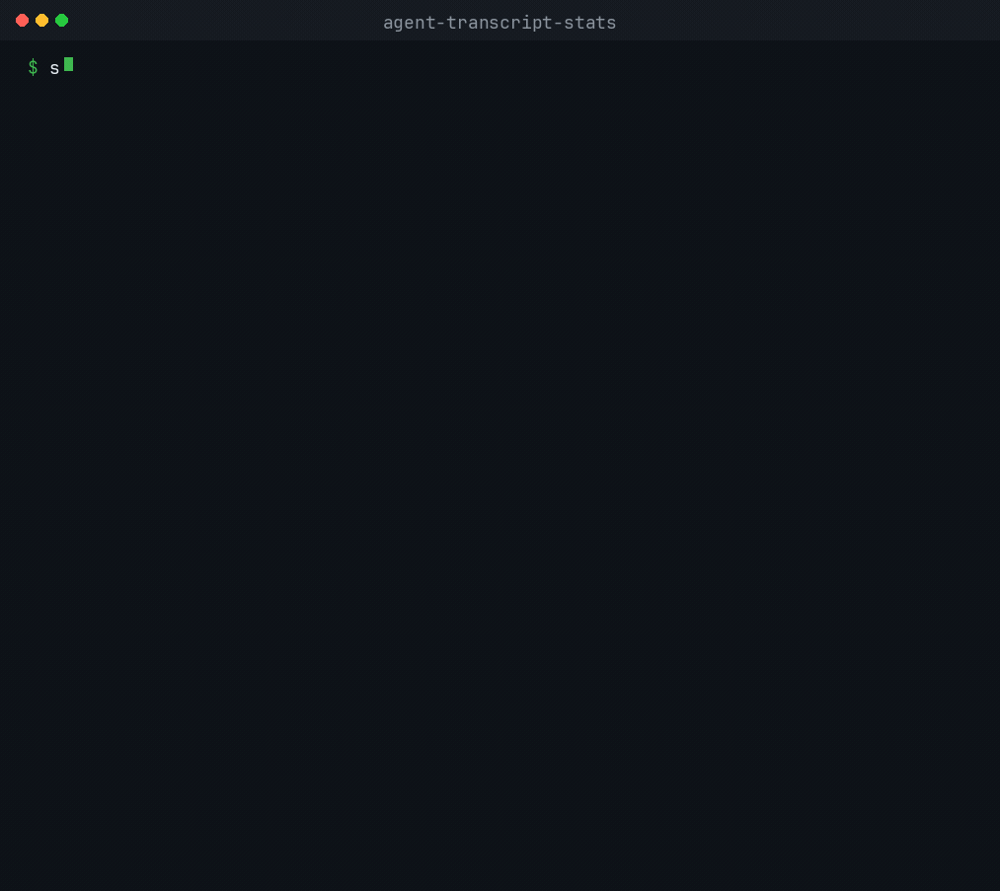

# agent-transcript-stats

Local command-line tool that reads agent transcript files on your machine and prints session and message counts. Nothing is sent to the network.

## What it prints



The `stats` command prints a text table by default:

- Total sessions, user messages, assistant messages, and tool calls
- Activity broken down by UTC day
- Top words from user-authored text (secrets removed)
- Per-source session counts
- Counts of skipped malformed lines and unreadable files

The same numbers are available as JSON (`--json`) or Markdown (`--md`).

## Privacy

`stats` reads transcript files from paths you pass, or from the default directories on your computer. It writes the report to stdout. It does not open a network connection, upload a transcript, or sign in to an account.

## Install

```bash
go install github.com/kamilkaczmareksolutions/agent-transcript-stats/cmd/stats@latest
```

Or build from a clone:

```bash
go build -o stats ./cmd/stats
```

## Usage

```bash
stats examples/
stats --json examples/
stats --md --top 10 examples/
stats --source codex ~/.codex
stats
```

Flags:

- `--json` — JSON report (two-space indent, trailing newline)
- `--md` — Markdown report
- `--top N` — number of top user words (default 20, minimum 1)
- `--source name` — filter to `claude`, `codex`, or `cursor` (repeatable)

`--json` and `--md` cannot be used together.

With no path arguments, `stats` scans default directories that exist:

- Claude Code: `~/.claude`
- Codex CLI: `$CODEX_HOME` or `~/.codex`
- Cursor: `$CURSOR_CONFIG_DIR` or `~/.cursor`

If none of those directories exist, the report is all zeros.

Exit codes: `0` success, `1` on context cancellation, `2` on bad flags, unknown source, invalid `--top`, or a missing path you named.

## Transcript paths

**Claude Code** stores JSONL under:

`~/.claude/projects/<encoded-project-path>/<session-id>.jsonl`

The encoded project path replaces `/` with `-` in the absolute project path. Files under a `subagents` directory are ignored.

**Codex CLI** stores JSONL under:

- `$CODEX_HOME/sessions/YYYY/MM/DD/rollout-*.jsonl`
- `$CODEX_HOME/archived_sessions/rollout-*.jsonl`

When the same session id appears in both live and archived trees, the live file under `sessions/` is used.

**Cursor (experimental)** stores JSONL under:

`${CURSOR_CONFIG_DIR:-~/.cursor}/projects/<encoded>/agent-transcripts/**/*.jsonl`

Cursor support is best-effort; formats change. `state.vscdb` is not read.

## Metrics

**Inclusion.** Claude user messages come from authored text blocks. A line that is only `tool_result` blocks is not a user message. Codex counts `response_item` records and ignores `event_msg` mirrors. Cursor counts `role` and `message.content` records. Claude `system`, `summary`, and `file-history-snapshot` records, and Codex `session_meta` and `event_msg` records, are ignored and do not increment skipped lines. Malformed JSON and lines longer than 32 MiB increment `skipped_lines`.

**Measurement.** User top words run through secret masking, then tokenization. Tokens are letters and digits. An apostrophe splits a token. The minimum length is 3. The English stopword list is `stopwords` in `stats.go`. Sort is count descending, then word ascending.

**Days.** A session counts on each UTC day it has activity. The total session count counts each session once.

Parsers are best-effort. Upstream export formats change; counts may drift until parsers are updated.

## Fixtures

The `examples/` tree is synthetic data for tests and demos. See `examples/README.md`.

## License

MIT. See [LICENSE](LICENSE). Copyright kamilkaczmareksolutions.
